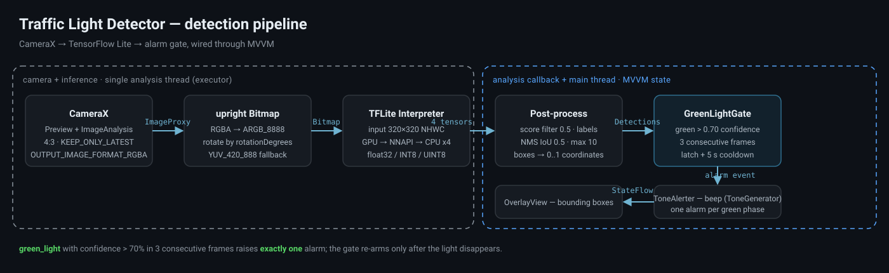
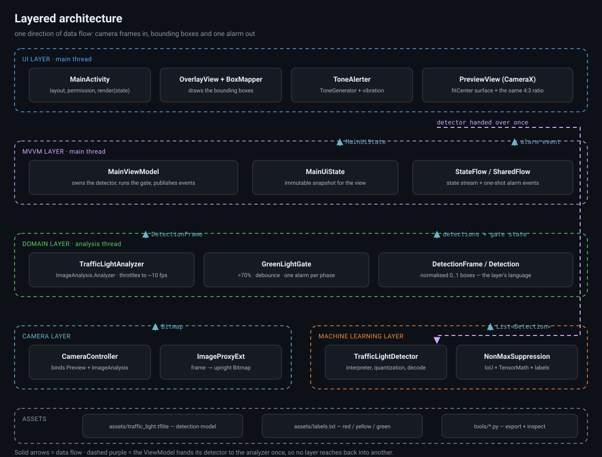
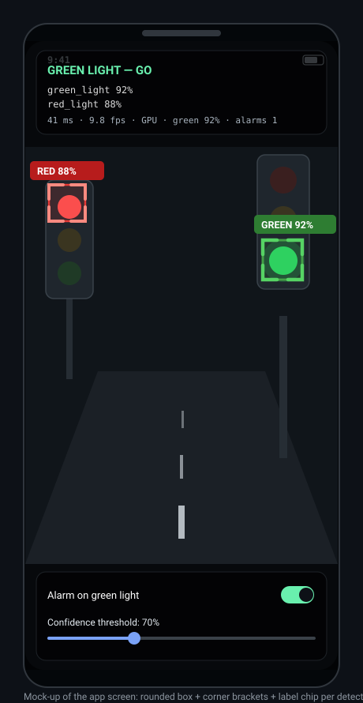

# Traffic Light Detector — Android · Kotlin · CameraX · TensorFlow Lite

แอป Android ตัวอย่างสำหรับ **ตรวจจับไฟจราจรแบบเรียลไทม์** ด้วยโมเดล `.tflite`
วาดกรอบ Bounding Box ทับภาพกล้อง และ **ส่งเสียงเตือนเมื่อเจอไฟเขียว (`green_light`)
ที่มีความมั่นใจมากกว่า 70%** — เตือนเพียง **ครั้งเดียวต่อการติดไฟเขียวหนึ่งรอบ**


[](https://github.com/NarDecH/traffic-light-detector/actions/workflows/android.yml)
[](https://github.com/NarDecH/traffic-light-detector/actions/workflows/release.yml)



---

## สารบัญ

- [ฟีเจอร์](#ฟีเจอร์)
- [รูปประกอบ](#รูปประกอบ)
- [เงื่อนไขของโจทย์ → อยู่ตรงไหนของโค้ด](#เงื่อนไขของโจทย์--อยู่ตรงไหนของโค้ด)
- [เริ่มต้นอย่างรวดเร็ว](#เริ่มต้นอย่างรวดเร็ว)
- [สถาปัตยกรรม](#สถาปัตยกรรม)
- [โครงสร้างโปรเจกต์](#โครงสร้างโปรเจกต์)
- [โมเดล](#โมเดล)
- [การปรับแต่ง](#การปรับแต่ง)
- [การทดสอบ](#การทดสอบ)
- [Release](#release)
- [เอกสารเพิ่มเติม](#เอกสารเพิ่มเติม)
- [ข้อจำกัด](#ข้อจำกัด)
- [License](#license)

## ฟีเจอร์

- 📷 **CameraX** — `Preview` + `ImageAnalysis` (4:3, `STRATEGY_KEEP_ONLY_LATEST`, `RGBA_8888`) ทำงานแบบเรียลไทม์
- 🧠 **TensorFlow Lite Interpreter** — เลือก backend อัตโนมัติ GPU → NNAPI → CPU (x4 threads) พร้อม fallback และบอกเหตุผลของ fallback บนแถบสถานะ (ไม่ต้องต่อ adb)
- 🎨 **รองรับทั้งโมเดล float32 และ quantized (INT8/UINT8)** — ตรวจจับ dtype, quantization parameters และค่า input scaling ให้เอง
- 🔤 **3 คลาส**: `red_light`, `yellow_light`, `green_light` — ผูกผ่าน `labels.txt` (ไม่ผูกกับ index ตายตัว)
- 🔔 **เตือนไฟเขียว > 70%** ด้วย `ToneGenerator` (สาย Alarm) + สั่น
- ⏱️ **Debounce / state machine** — ยืนยัน 3 เฟรมติดกัน, เตือนครั้งเดียวต่อรอบไฟเขียว, มี cooldown กันเสียงรัว
- 🟩 **วาด Bounding Box เอง** — กรอบมุมโค้ง + corner bracket แบบ HUD + ป้าย `GREEN 92%` ที่พลิก/หนีบขอบอัตโนมัติ
- 🧱 **MVVM** — `StateFlow<MainUiState>` สำหรับ state, `SharedFlow` สำหรับ one-shot alarm event, View ไม่มีตรรกะการตรวจจับ
- ✅ **Unit test บน JVM** — ครอบคลุม state machine ของการเตือน, NMS, label mapping และการแปลงพิกัด (ไม่ต้องมีมือถือ)

## รูปประกอบ

| รูป | คำอธิบาย |
|-----|----------|
|  | **Pipeline** จากกล้อง → TFLite → gate → เสียง/กรอบ (มีเส้นแบ่ง thread และชนิดข้อมูลบนลูกศร) |
|  | **สถาปัตยกรรมแบบ layer** (UI / MVVM / Domain / Camera / ML / Assets) |
|  | **หน้าจอแอป** — กรอบที่วาดจริง ป้ายกำกับ, status panel และแถบควบคุม |

## เงื่อนไขของโจทย์ → อยู่ตรงไหนของโค้ด

| # | เงื่อนไข | คลาส / ไฟล์ |
|---|---------|-------------|
| 1 | CameraX ดึงภาพเรียลไทม์ เข้า `ImageAnalysis` แล้วส่งเข้าโมเดล | [CameraController.kt](app/src/main/java/com/example/trafficlightdetector/camera/CameraController.kt), [TrafficLightAnalyzer.kt](app/src/main/java/com/example/trafficlightdetector/domain/TrafficLightAnalyzer.kt) |
| 2 | Label 3 คลาส `red_light` / `yellow_light` / `green_light` | [TrafficLightClass.kt](app/src/main/java/com/example/trafficlightdetector/ml/TrafficLightClass.kt), [labels.txt](app/src/main/assets/labels.txt), [TrafficLightLabels.kt](app/src/main/java/com/example/trafficlightdetector/ml/TrafficLightLabels.kt) |
| 3 | ไฟเขียว confidence > 70% → ส่งเสียงปลุก | [GreenLightGate.kt](app/src/main/java/com/example/trafficlightdetector/domain/GreenLightGate.kt) (`DEFAULT_CONFIDENCE_THRESHOLD = 0.70f`), [ToneAlerter.kt](app/src/main/java/com/example/trafficlightdetector/alarm/ToneAlerter.kt) |
| 4 | Debounce / สเตทเช็ค ให้เตือนครั้งเดียวต่อไฟเขียวหนึ่งรอบ | [GreenLightGate.kt](app/src/main/java/com/example/trafficlightdetector/domain/GreenLightGate.kt) (state machine `ARMED` ↔ `GREEN_ACTIVE` + cooldown 5 วินาที) |
| 5 | MVVM + การวาดกรอบ Bounding Box | [MainViewModel.kt](app/src/main/java/com/example/trafficlightdetector/ui/MainViewModel.kt), [MainUiState.kt](app/src/main/java/com/example/trafficlightdetector/ui/MainUiState.kt), [OverlayView.kt](app/src/main/java/com/example/trafficlightdetector/ui/OverlayView.kt), [BoxMapper.kt](app/src/main/java/com/example/trafficlightdetector/ui/BoxMapper.kt) |

## เริ่มต้นอย่างรวดเร็ว

```bash
git clone https://github.com/NarDecH/traffic-light-detector.git
cd traffic-light-detector

# 1) โมเดล: วางไฟล์ไว้ที่ app/src/main/assets/traffic_light.tflite
#    (ยังไม่มีโมเดล? ใช้โมเดลปลอมเพื่อทดสอบ pipeline ทั้งเส้น)
python tools/make_dummy_model.py

# 2) ตรวจสัญญา I/O ของโมเดลก่อนใช้งาน
python tools/inspect_model.py app/src/main/assets/traffic_light.tflite

# 3) build และรัน unit test (ต้องมี JDK 17 + Android SDK 36)
./gradlew :app:testDebugUnitTest
./gradlew :app:assembleDebug
```

เปิดโปรเจกต์ด้วย Android Studio แล้วรันบน **เครื่องจริง** (แนะนำ เพราะจำลองกล้องใน emulator ได้จำกัด)
กด Allow สิทธิ์กล้อง แล้วชี้ไปที่ไฟจราจร

> โปรเจกต์ไม่เก็บไฟล์ `gradle/wrapper/gradle-wrapper.jar` (ไบนารี) — Android Studio จะ generate ให้ตอน Sync
> หรือสั่ง `gradle wrapper --gradle-version 8.11.1` ถ้ามี Gradle ในเครื่อง

## สถาปัตยกรรม


ทิศทางข้อมูลมีทางเดียว — ภาพจากกล้องไหลขึ้นมาถึง UI ไม่มี layer ไหนเรียกย้อนกลับไปหาอีก layer
(ยกเว้น ViewModel ส่ง detector ให้ analyzer ครั้งเดียวผ่าน lambda `detectorProvider`)

- **UI (main thread)** — `MainActivity` ขอสิทธิ์, ผูก CameraX, `render(state)`; `OverlayView` วาดกรอบ; `ToneAlerter` เล่นเสียง
- **MVVM (main thread)** — `MainViewModel` ถือ detector + gate, ปล่อย `StateFlow<MainUiState>` และ `SharedFlow<Unit>`
- **Domain (analysis thread)** — `TrafficLightAnalyzer` (throttle ~10 fps), `GreenLightGate` (เกณฑ์ + debounce), `Detection`/`DetectionFrame`
- **Camera** — `CameraController` (binding), `ImageProxyExt` (frame → Bitmap ตั้งตรง)
- **ML** — `TrafficLightDetector` (interpreter + quantization + decode), `NonMaxSuppression`, `TensorMath`, `TrafficLightLabels`

รายละเอียดเชิงลึก (threading, data contract, sequence diagram, state machine) อยู่ที่ **[docs/ARCHITECTURE.md](docs/ARCHITECTURE.md)**

## โครงสร้างโปรเจกต์

```
app/src/main/java/com/example/trafficlightdetector/
├── MainActivity.kt                 View ของ MVVM
├── alarm/                          Alerter (interface) + ToneAlerter (ToneGenerator, audio focus, สั่น)
├── camera/                         CameraController + ImageProxyExt (RGBA fast path, YUV fallback)
├── domain/                         TrafficLightAnalyzer, GreenLightGate, DetectionFrame
├── ml/                             TrafficLightDetector, AcceleratorFallback, Detection, TrafficLightClass,
│                                   TrafficLightLabels, NonMaxSuppression, TensorMath
└── ui/                             MainViewModel, MainUiState, OverlayView, BoxMapper

app/src/main/assets/labels.txt      รายชื่อคลาสของโมเดล (0 = red_light)
app/src/test/java/...               Unit test บน JVM (gate, NMS, labels, box mapping)
docs/                               เอกสาร + รูปประกอบ (SVG)
tools/                              สคริปต์ Python: ตรวจชุดข้อมูล/เทรน/export/ตรวจสอบโมเดล/ตรวจ backend บนเครื่อง
```

## โมเดล

แอปคาดหวังโมเดล **object detection** มาตรฐานของ TFLite (output แบบ `TFLite_Detection_PostProcess`)
จำนวน 4 tensor:

| Tensor | Shape | ความหมาย |
|--------|-------|----------|
| locations | `[1, N, 4]` | `ymin, xmin, ymax, xmax` (normalized 0..1) |
| classes | `[1, N]` | index ของคลาส → อ่านชื่อจาก `labels.txt` |
| scores | `[1, N]` | confidence 0..1 (ถ้าเป็น logits โค้ดจะ `sigmoid` ให้) |
| num_detections | `[1]` | จำนวนผลลัพธ์ที่ใช้ได้จริง (ไม่บังคับ) |

Input `[1, H, W, 3]` (NHWC) รองรับ float32 / INT8 / UINT8 — โค้ดจะเดา domain ของ input
(`0..1`, `0..255`, `-1..1`) ให้อัตโนมัติ และ override ได้ผ่าน `Config.inputScaling`

```bash
pip install -r tools/requirements.txt        # Python 3.9–3.11 (tflite-model-maker)
python tools/validate_dataset.py --dataset dataset                             # ตรวจชุดข้อมูลก่อนเทรน (ไม่ต้องติดตั้งอะไร)
python tools/export_tflite.py --dataset dataset --output app/src/main/assets    # เทรน EfficientDet-Lite0 (ตรวจชุดข้อมูลให้ก่อน)
python tools/make_dummy_model.py             # โมเดลปลอมสำหรับทดสอบ pipeline
python tools/inspect_model.py <model.tflite> # ตรวจ I/O ก่อนวางลง assets
python tools/check_device_backend.py         # ติดตั้ง+เปิดแอปบนเครื่อง แล้วตรวจบรรทัด backend fallback
```

การเตรียมชุดข้อมูล (Pascal VOC), ขั้นตอนเทรน, quantization และการเลือกค่า input scaling: **[docs/MODEL.md](docs/MODEL.md)**
คู่มือทำจริงตั้งแต่เก็บภาพจนทดสอบบนถนน: **[docs/TRAINING.md](docs/TRAINING.md)**

## การปรับแต่ง

| ค่า | ที่ตั้ง | ค่าเริ่มต้น |
|-----|--------|-------------|
| เกณฑ์ confidence | `GreenLightGate.DEFAULT_CONFIDENCE_THRESHOLD` + สไลเดอร์บนหน้าจอ | 0.70 |
| เฟรมยืนยันก่อนเตือน | `GreenLightGate.DEFAULT_CONFIRM_FRAMES` | 3 |
| เฟรมที่ไฟเขียวหายก่อน re-arm | `GreenLightGate.DEFAULT_RELEASE_MISS_FRAMES` | 4 |
| ระยะห่างขั้นต่ำระหว่างการเตือน | `GreenLightGate.DEFAULT_MIN_ALARM_INTERVAL_MILLIS` | 5,000 ms |
| เกณฑ์ตัดกรอบ / จำนวนกรอบ / IoU | `TrafficLightDetector.Config` | 0.5 / 10 / 0.5 |
| ความถี่ inference | `TrafficLightAnalyzer.DEFAULT_INTERVAL_MILLIS` | 100 ms (~10 fps) |
| Backend | `TrafficLightDetector.Config.useGpuDelegate`, `useNnApiDelegate` | GPU → (NNAPI ปิด) → CPU x4 |
| ขนาดภาพ Preview / Analysis | `CameraController.PREVIEW_SIZE`, `ANALYSIS_SIZE` | 1280×960 / 640×480 |

ตารางเต็มพร้อมผลกระทบของแต่ละค่า: **[docs/CONFIGURATION.md](docs/CONFIGURATION.md)**

## การทดสอบ

```bash
./gradlew :app:testDebugUnitTest     # unit test บน JVM
```

| ชุดทดสอบ | ตรวจอะไร |
|----------|----------|
| `GreenLightGateTest` | เกณฑ์ "> 70%" (0.70 พอดีไม่เตือน), 3 เฟรมติดกัน, เตือนครั้งเดียวต่อรอบ, re-arm, cooldown กันสั่น, เพิกเฉยไฟแดง/เหลือง |
| `NonMaxSuppressionTest` | IoU และการยุบกรอบซ้ำ (แยกตามคลาส) |
| `TrafficLightLabelsTest` | parse `labels.txt`, จับคู่ label แบบไม่สนใจตัวพิมพ์/ช่องว่าง, label ที่ไม่รู้จัก |
| `BoxMapperTest` | การแปลงพิกัดแบบ `fitCenter` (มี/ไม่มีแถบดำ) |
| `AcceleratorFallbackTest` | ข้อความเหตุผลของ backend ที่ถูกปฏิเสธ (`message` ว่าง → ชื่อคลาส, ตัดความยาว, ห้ามว่างเปล่า) |

เทสต์บนอุปกรณ์จริง (instrumentation — โหลดโมเดลจริงและรัน `detect()` ซ้ำหลายเฟรมกับ TFLite):

```bash
./gradlew :app:connectedDebugAndroidTest    # ต้องต่ออุปกรณ์ (ดูรายละเอียดใน docs/TESTING.md §1.2)
```

Checklist การทดสอบบนเครื่องจริง + วิธีวัด FPS/inference time: **[docs/TESTING.md](docs/TESTING.md)**

## Release

ทุกครั้งที่ push tag `v*` CI จะรันเทสต์ทั้งหมด, build `:app:assembleRelease` แล้วสร้าง **GitHub Release**
ให้อัตโนมัติ (ดู [.github/workflows/release.yml](.github/workflows/release.yml)) — ดาวน์โหลด APK พร้อม
checksum `.sha256` ได้จาก [หน้า Releases](https://github.com/NarDecH/traffic-light-detector/releases)
โดยเนื้อหาของ release มาจากส่วนของรุ่นนั้นใน [CHANGELOG.md](CHANGELOG.md)

- **APK ยังไม่ถูกเซ็นโดยค่าเริ่มต้น** — ติดตั้งตรง ๆ ไม่ได้จนกว่าจะตั้ง signing secrets (ขั้นตอนอยู่ใน [CONTRIBUTING.md](CONTRIBUTING.md))
- รีโปนี้ไม่เก็บไฟล์โมเดล: แท็กที่ไม่มี `.tflite` จะได้ APK ที่ขึ้น `Model error` — เทรน/วางโมเดลตาม [docs/TRAINING.md](docs/TRAINING.md)

## เอกสารเพิ่มเติม

| เอกสาร | เนื้อหา |
|--------|--------|
| [docs/ARCHITECTURE.md](docs/ARCHITECTURE.md) | layer, threading, ลำดับการทำงาน (sequence), state machine, data contract, จุดขยาย |
| [docs/MODEL.md](docs/MODEL.md) | สัญญา I/O ของโมเดล, ชุดข้อมูล, การเทรน/export, quantization, input scaling |
| [docs/TRAINING.md](docs/TRAINING.md) | คู่มือทำโมเดลจริงทีละขั้น: เตรียมเครื่อง, เก็บ/ตรวจชุดข้อมูล, เทรน, ติดตั้ง, เกณฑ์ทดสอบภาคสนาม |
| [docs/CONFIGURATION.md](docs/CONFIGURATION.md) | ทุกพารามิเตอร์ที่จูนได้ + ผลกระทบ/ข้อแลกเปลี่ยน |
| [docs/TESTING.md](docs/TESTING.md) | แผนการทดสอบ, checklist ภาคสนาม, การวัดประสิทธิภาพ |
| [docs/TROUBLESHOOTING.md](docs/TROUBLESHOOTING.md) | อาการที่พบบ่อยและวิธีแก้ |
| [docs/ROADMAP.md](docs/ROADMAP.md) | แนวทางต่อยอด |
| [CONTRIBUTING.md](CONTRIBUTING.md) | วิธี contribute, สไตล์โค้ด, การรัน test/CI |
| [CHANGELOG.md](CHANGELOG.md) | ประวัติเวอร์ชัน |

## ข้อจำกัด

- รองรับเฉพาะโมเดล detection ที่มี NMS อยู่ในกราฟ (`TFLite_Detection_PostProcess`) —
  โมเดลตระกูล YOLO ที่ยังไม่ decode anchor/NMS ต้องเพิ่มขั้นตอน decode เอง
- เป็นตัวอย่างเพื่อการเรียนรู้ **ไม่ควรใช้เป็นระบบช่วยขับขี่จริง** (ยังไม่มีระยะห่างปลอดภัย,
  ไม่มีการชดเชยแสงกลางคืน, ไม่มี fail-safe เมื่อกล้องหรือโมเดลล้มเหลว)
- `OverlayView` แปลงพิกัดแบบ `fitCenter` ให้ตรงกับ `PreviewView` ที่ตั้ง `app:scaleType="fitCenter"`
  — ถ้าเปลี่ยน `scaleType` ต้องแก้ `BoxMapper` ให้ตรงกัน

- รีโปนี้ไม่เก็บไฟล์โมเดล (`.tflite`) — ต้องเทรน/วางเองตาม [docs/TRAINING.md](docs/TRAINING.md); APK ที่ CI แนบ
  ในหน้า Release จึงยังไม่มีโมเดลจนกว่าจะออกเวอร์ชันที่มีโมเดลจริง

## License

[MIT](LICENSE) — ใช้และดัดแปลงได้อย่างอิสระ
