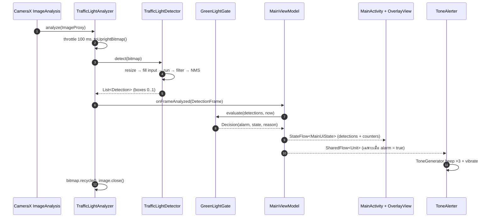
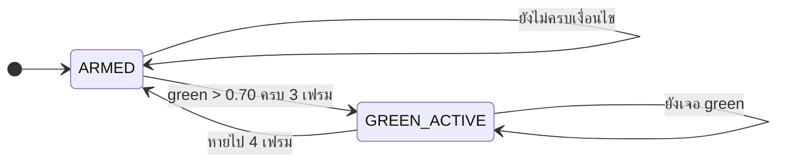
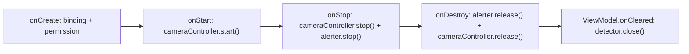

# สถาปัตยกรรม (Architecture)

เอกสารนี้อธิบายโครงสร้างภายในของแอป: การแบ่ง layer, เธรดที่โค้ดแต่ละส่วนทำงาน,
สัญญาข้อมูลระหว่างชั้น, ลำดับการทำงานต่อหนึ่งเฟรม และเหตุผลเบื้องหลังการออกแบบ


---

## 1. หลักการออกแบบ

1. **ข้อมูลไหลทางเดียว** — กล้อง → analyzer → detector → gate → ViewModel → View
   ไม่มีชั้นไหนเรียกย้อนกลับไปหาชั้นล่าง (ข้อยกเว้นเดียวคือ ViewModel ส่ง *detector*
   ให้ analyzer ผ่าน lambda `detectorProvider` ตอนสร้าง analyzer)
2. **แยก "การตัดสินใจ" ออกจาก "การแสดงผล"** — `GreenLightGate` ตัดสินใจว่า *ควรเตือนไหม*,
   `ToneAlerter` แค่ *เล่นเสียง*, `OverlayView` แค่ *วาดกรอบ*
3. **โค้ดที่ทดสอบได้ต้องไม่ผูกกับ Android** — state machine, NMS, quantization,
   การแปลงพิกัด เป็น Kotlin ล้วน (รัน unit test บน JVM ได้)
4. **หนึ่งเฟรม = หนึ่งข้อเท็จจริง** — ทุกอย่างที่ UI ต้องรู้ถูกส่งมาใน `DetectionFrame`
   แล้วรวมเป็น `MainUiState` ก้อนเดียว

## 2. Layer และความรับผิดชอบ

| Layer | เธรด | คลาส | หน้าที่ |
|-------|------|------|--------|
| UI | main | `MainActivity` | ขอสิทธิ์กล้อง, ผูก CameraX, `render(state)`, sync สวิตช์/สไลเดอร์ |
| UI | main | `OverlayView` | วาดกรอบ + corner bracket + ป้ายกำกับลงบน `Canvas` |
| UI | main | `BoxMapper` | แปลงพิกัด normalized → pixel แบบ `fitCenter` (pure function) |
| UI | main | `ToneAlerter` | `ToneGenerator` + audio focus + สั่น |
| MVVM | main | `MainViewModel` | ถือ detector, รัน gate, ปล่อย `StateFlow` / `SharedFlow` |
| MVVM | main | `MainUiState` | snapshot ที่ View เอาไปวาด (immutable data class) |
| Domain | analysis | `TrafficLightAnalyzer` | รับ `ImageProxy`, throttle, แปลงเป็น Bitmap, เรียก detector |
| Domain | analysis | `GreenLightGate` | เกณฑ์ 70% + debounce + cooldown → ตัดสินใจเตือน |
| Domain | analysis | `DetectionFrame`, `Detection` | โครงข้อมูลผลลัพธ์ |
| Camera | main | `CameraController` | ผูก `Preview` + `ImageAnalysis` เข้ากับ lifecycle |
| Camera | analysis | `ImageProxyExt` | `ImageProxy` → upright `Bitmap` (RGBA fast path, YUV fallback) |
| ML | analysis | `TrafficLightDetector` | Interpreter, delegate, quantization, decode output เป็น `Detection` |
| ML | analysis | `NonMaxSuppression`, `TensorMath`, `TrafficLightLabels`, `TrafficLightClass` | งานคำนวณและ mapping ที่ทดสอบได้ |

## 3. Threading model

| เธรด | อะไรทำงาน | ข้อกำหนด |
|------|-----------|----------|
| **main** | lifecycle, view binding, render, `ToneAlerter`, `MainViewModel` (ยกเว้น `onFrameAnalyzed`) | ห้ามทำงานหนัก/บล็อก |
| **analysis (single thread executor)** | `TrafficLightAnalyzer.analyze`, `ImageProxyExt`, `TrafficLightDetector.detect`, `GreenLightGate` | ทีละเฟรมเสมอ → `Interpreter` และ gate ไม่ต้องมี lock |
| **Dispatchers.IO** | โหลดโมเดล + สร้าง interpreter ตอนเปิดแอป | ครั้งเดียวตอน init |
| **CameraX internal** | capture, surface ของ Preview | ไม่แตะจากโค้ดเรา |

กติกาสำคัญ:

- `ImageProxy` ถูก `close()` ใน `finally` ทุกครั้ง แม้เกิด exception → บัฟเฟอร์กลับคืน CameraX ทันที
- `STRATEGY_KEEP_ONLY_LATEST` + throttle 100 ms → ไม่มีคิวเฟรมสะสมตอน inference ช้า
- `detector` เป็น `@Volatile` ใน ViewModel: เขียนจาก main (ตอนโหลดเสร็จ) อ่านจาก analysis thread
- `TrafficLightDetector.detect()` / `close()` เป็น `@Synchronized` → ปลอดภัยแม้ ViewModel ถูกเก็บกวาดระหว่าง inference
- `MainUiState` ถูกอัปเดตผ่าน `MutableStateFlow.update {}` (thread-safe) จาก analysis thread ได้เลย

## 4. ลำดับการทำงานต่อหนึ่งเฟรม



## 5. State machine ของการเตือน



เหตุผลของแต่ละกลไก:

| กลไก | ค่า | ทำไม |
|------|-----|------|
| เกณฑ์ confidence | `> 0.70` (เข้มกว่า — 0.70 พอดีไม่นับ) | ตรงตามโจทย์ "มากกว่า 70%" |
| ยืนยัน 3 เฟรมติดกัน | `confirmFrames = 3` | ตัด false positive เฟรมเดียว (แสงสะท้อน, ป้ายสีเขียว) |
| latch ที่ `GREEN_ACTIVE` | ทันทีที่ยืนยัน | กันการยิงซ้ำในเฟรมถัด ๆ ไป |
| release 4 เฟรม | `releaseMissFrames = 4` | ไม่ re-arm เพราะกล้องกระตุก/หลุดเพียงเฟรมเดียว |
| cooldown 5 วินาที | `minAlarmIntervalMillis` | safety net สุดท้าย กันเสียงรัวถ้าโมเดลสลับไปมา |

`reset()` ใช้เมื่อต้องการ re-arm ทันที (เช่น เปลี่ยนสถานะการใช้งาน) — `MainViewModel.setAlarmEnabled()`
**ไม่** reset เพื่อไม่ให้เปิดเสียงแล้วดังย้อนหลังสำหรับไฟเขียวที่ผ่านไปแล้ว

## 6. สัญญาข้อมูลระหว่างชั้น

```
ImageProxy ──(ImageProxyExt)──► Bitmap (ARGB_8888, ตั้งตรง)
Bitmap ──(TrafficLightDetector)──► List<Detection>   พิกัด normalized 0..1, เรียงตาม confidence
List<Detection> + ขนาดภาพ + เวลา ──► DetectionFrame
DetectionFrame ──(GreenLightGate)──► Decision(alarm, state, reason, greenConfidence)
DetectionFrame + Decision ──► MainUiState ──► OverlayView / TextView
Decision.alarm ──► SharedFlow<Unit> ──► Alerter.alert()
```

**ทำไมใช้พิกัด normalized 0..1** — detector ไม่รู้จักขนาดจอ และ overlay ไม่ต้องรู้
ความละเอียดกล้อง (640×480 หรือ 1280×960 ก็ให้ผลเหมือนกัน) การแปลงเกิดขึ้นครั้งเดียวใน `BoxMapper`

**ทำไมไม่ส่ง Bitmap ให้ UI** — บิตแมปถูก recycle ทันทีหลัง inference เพื่อคืนหน่วยความจำ
UI ได้แค่ตัวเลขที่จำเป็น (พิกัด + ขนาดเฟรม) จึงไม่มีปัญหาการเข้าถึงบิตแมปที่ถูกคืนไปแล้ว

## 7. การวาดกรอบให้ตรงกับภาพ

`PreviewView` ใช้ `app:scaleType="fitCenter"` (ภาพทั้งเฟรมพอดีจอ, มีแถบดำ)
ดังนั้นพื้นที่ที่ภาพวาดจริงไม่เท่ากับพื้นที่ View:

```kotlin
// BoxMapper.contentRect(...)
imageAspect > viewAspect → แถบดำบน-ล่าง, content สูง = viewWidth / imageAspect
else                     → แถบดำซ้าย-ขวา, content กว้าง = viewHeight * imageAspect
// แล้วจึง map: x_pixel = content.left + normalX * content.width
```

`CameraController` ตั้ง aspect ratio ของ Preview และ ImageAnalysis เป็น 4:3 ทั้งคู่
เพื่อให้ aspect ของเฟรมที่วิเคราะห์ = aspect ของภาพที่แสดง (ถ้าต่างกัน กรอบจะเหลื่อม)
การหมุนจอไม่กระทบ เพราะ `ImageProxyExt` หมุนบิตแมปตาม `imageInfo.rotationDegrees`
ทุกเฟรม แล้วส่งขนาดจริงของบิตแมปที่หมุนแล้วขึ้นไปให้ overlay

## 8. การจัดการข้อผิดพลาด

| เหตุการณ์ | พฤติกรรม |
|-----------|----------|
| ไม่ได้สิทธิ์กล้อง | แสดงข้อความใน `messageTextView` ไม่เริ่มกล้อง |
| ผูกกล้องไม่สำเร็จ | `CameraController.onError` → แสดงข้อความ + log |
| โหลดโมเดลไม่ได้ (`create` throw) | `DetectorStatus.Error` + ข้อความ, analyzer จะทิ้งเฟรมทั้งหมด (แอปไม่ crash) |
| GPU delegate ใช้ไม่ได้ | ไล่ fallback อัตโนมัติ GPU → NNAPI → CPU แล้วรายงานชื่อ backend ที่ใช้จริงบนหน้าจอ พร้อมเหตุผลที่ตกไป backend นั้น (`AcceleratorFallback` → `MainUiState.acceleratorFallbacks`) |
| เฟรมใดเฟรมหนึ่งพัง | จับ exception ใน `analyze()` → log แล้วไปเฟรมถัดไป (กล้องไม่ตายทั้ง pipeline) |
| Tensor output ไม่ตรงสัญญา | `require(...)` ตอนสร้าง detector พร้อมข้อความอธิบายว่าพบอะไร |
| ToneGenerator สร้างไม่ได้ | log + `onError` แล้วทำงานต่อโดยไม่มีเสียง (UI ยังวาดกรอบ) |

## 9. Lifecycle



รายละเอียดของแต่ละช่วง:

| ช่วง | สิ่งที่เกิดขึ้น |
|------|------------------|
| `onCreate` | inflate layout, sync สวิตช์/สไลเดอร์, เริ่มโหลดโมเดล (IO), ขอสิทธิ์กล้อง |
| `onStart` | ผูก CameraX ใหม่ (หลังกลับจาก background) |
| `onStop` | `clearAnalyzer()` + `unbindAll()` และหยุดเสียงที่ค้างอยู่ |
| `onDestroy` | `alerter.release()` (คืน native audio) → `cameraController.release()` (ปิดเธรดวิเคราะห์) |
| `ViewModel.onCleared` | `detector.close()` (ปิด interpreter + delegate) — เกิดหลังกล้องหยุดแล้วเท่านั้น |

ลำดับนี้ตั้งใจให้ **กล้องหยุดก่อน detector ถูกปิด** เพื่อไม่ให้ analyzer เรียก
interpreter ที่ปิดไปแล้ว (และ `@Synchronized` เป็นด่านสุดท้าย)

## 10. จุดขยาย (Extension points)

| อยากได้อะไร | แก้ที่ไหน |
|-------------|-----------|
| เสียงพูด/ไฟล์เสียงเอง (MediaPlayer) | implement `Alerter` ตัวใหม่ ไม่ต้องแตะ ViewModel |
| เพิ่มคลาส (เช่น `arrow_light`, `pedestrian_light`) | เพิ่มใน `TrafficLightClass` + บรรทัดใน `labels.txt` (ไม่ต้องแก้ detector) |
| เปลี่ยนกติกาการเตือน (เช่นเตือนไฟเหลืองด้วย) | เพิ่ม state ใน `GreenLightGate` หรือสร้าง gate ตัวใหม่ที่ implement interface เดียวกัน |
| ใช้ Compose แทน XML | `MainActivity` เก็บแค่ `render(state)` → เปลี่ยนเป็น Compose + `collectAsState()` แล้วลบ `OverlayView` (วาดกรอบด้วย `Canvas` ของ Compose ได้) |
| ตรวจจับหลายไฟพร้อมกัน + tracking | เพิ่ม tracker ใน `ml/` ที่รับ `List<Detection>` ต่อเฟรม แล้วเก็บ id ต่อเนื่อง |
| โมเดลหลายตัวสลับกัน | `TrafficLightDetector.create()` เป็น factory อยู่แล้ว — ทำ `DetectorSelector` ที่เลือกโมเดลตามเวลา/สภาพแสง |

## 11. หมายเหตุด้านประสิทธิภาพ

- **throttle 100 ms** — inference ไฟจราจรไม่ต้อง 30 fps แล้วประหยัดแบตและความร้อน
  (ปรับได้ที่ `TrafficLightAnalyzer.DEFAULT_INTERVAL_MILLIS`)
- **ย่อภาพเป็นขนาด input ของโมเดล** — `Bitmap.createScaledBitmap` ครั้งเดียวต่อเฟรม
- **บิตแมปถูก recycle ทุกเฟรม** — ลด GC pressure; หลีกเลี่ยงการ bump allocation ใน loop
- **อัลโลเคชันคงที่ต่อเฟรม** — `IntArray` ของพิกเซล, `ByteBuffer` ของ input/output,
  `RectF`/`Path` ของ overlay ถูก reuse ทั้งหมด (ไม่มี allocation ใหม่ใน `onDraw`)
- **delegate** — GPU เร็วที่สุดกับโมเดล float32; NNAPI มีประโยชน์กับ INT8 แต่เปิดเป็น
  opt-in เพราะบางอุปกรณ์ช้ากว่า CPU
